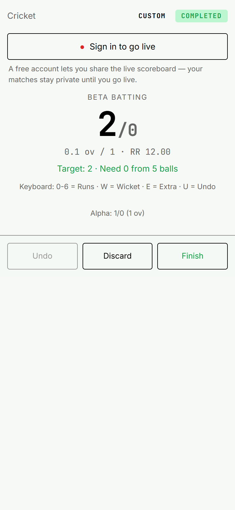
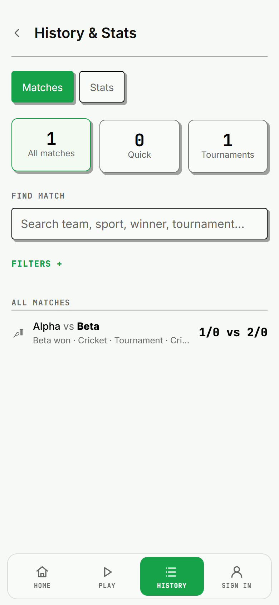
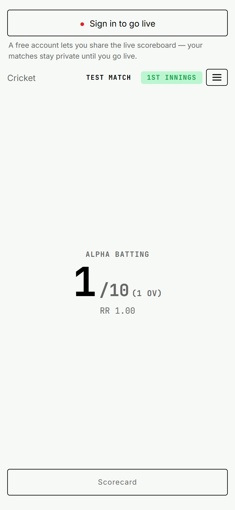
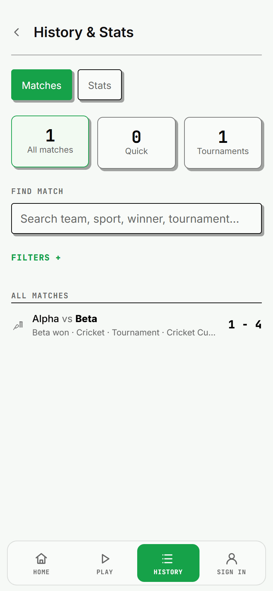

# Cricket completion: Finish must leave the scorer behind

Current expected-failure inventory after the navigation decisions: **4 routing / 7 repository-wide**. RA-5 now passes normally: setup leaves freely and scoring arms the existing guard. RA-9 also passes normally after the own-key registry lookup. SA-07 now passes normally after round two saves the final Undo with the persistent scoring-started latch; three stability failures remain. Counts in dated validation runs below describe those historical heads.

Finishing a cricket tournament match previously pushed its tournament screen onto the browser history. Back reopened the completed scorer; Test cricket could reopen at the first innings. Cricket completion now uses the app-owned completion seam, which unwinds the scorer and its exit-guard entries. Test quick matches land on History. Isolated scorers without the provider replace their current entry.

## Acceptance evidence

| Format | Walk and saved-data checks | Evidence |
| --- | --- | --- |
| Limited-overs tournament | Finish → tournament → browser Back → History. Alpha 1/0 from 6 balls, Beta 2/0 from 1 ball and winner Beta remain saved. A separate test records a stroke, remounts, restores Undo and finishes with the corrected 4/0 from 1 ball. | Running browser and focused tests |
| Limited-overs quick | Restore a draft and its Undo history; undo the last run, score Four, then leave the in-place result through Back. Saved innings remain Alpha 1/0 from 6 balls and Beta 4/0 from 1 ball. | App route contract; this path already finished in place |
| Test tournament | Score Four in the fourth innings → Save & Return → tournament → browser Back → History. All four innings remain saved, including the final 4/0 from 1 ball. Restore/remount/Undo and the Finish & save menu exit are covered separately. | Running browser and focused tests |
| Test quick | Score Four → Save & Return → History → browser Back → History. All four innings, final score, winner and result survive. Restore/remount/Undo and the Finish & save menu exit are covered separately. | Running browser and focused tests |
| Guided tournament | Score Four to complete the chase → tournament → browser Back → History. The aggregate innings and winner remain saved; the completion callback runs once. Existing guided scorer tests also cover the scoring engine and transitions. | Running browser and focused tests |

Finished drafts are intentionally cleared. Undo is exercised before completion and across scorer remount; finished results do not acquire a new Undo feature. Draft/Discard navigation, sport rules and tennis are outside this fix.

## Phone demo

The app ran with `bun run dev --host 127.0.0.1 --port 5173 --strictPort`. Another worktree owned IPv6 localhost:5173, so this worktree used the independent IPv4 binding. The repository Chrome sweep used a 390×844 CSS-pixel mobile viewport at device scale factor 2; PNG files are 780×1688. All 18 captures were visually inspected.

`before.json` uses the cricket implementations from master (`0038e60`) temporarily in this worktree; the fixed sources were restored afterward. Both tournament formats return to the scorer after Back. `after.json` uses the fixed code: all four routed formats return to History with completed data. Its only console warning is Chrome blocking synthetic vibration calls in the three power-scorer cases; guided has none.

The T3 preview failed twice with `Preview automation snapshot timed out after 15000ms.` The screenshots were captured with the repository's `scripts/route-sweep.mjs` Chrome workflow. Master's secure Chrome bootstrap is preserved.

| Match | Before: Back reopens scorer | After: Back reaches History |
| --- | --- | --- |
| Limited-overs tournament |  |  |
| Test tournament |  |  |

The `*_scorer.png` and `*_after_Finish.png` files record the scoring and result screens on both sides of the fix. The after directory also contains quick-Test and guided completion captures.

## Validation at the hold point

- Focused Vitest: **13 files passed; 157 tests passed; 11 expected failures; 168 total**. Includes every cricket scorer/spectator test, `CricketFinishNavigation`, route contracts, both stability-audit files and palette.
- Route contracts: **34 total; 27 normal passes; 7 expected failures**.
- Finish navigation: **13 passed**, including completed innings, fallback navigation, menu exits and restored Undo after remount.
- Palette: exact raw literal count **669**; BASELINE and exclusions unchanged.
- Lint: **0 errors, 29 warnings**. Type-check passed.
- Browser sweep: before **0/2** completion contracts satisfied; after **4/4** satisfied. JSON and screenshots are alongside this file.
- Expected failures: routing **7 before / 7 after**; repository-wide **11 before / 11 after**. Master had no separate cricket expected-failure contract to flip; five passing cricket route cases were added.
- Full suite and production build: **not run at this checkpoint**. At the time, the normal pre-push hook owned both after “lane free”; no hosted checks or PR existed yet. For current validation, read the required CI `verify` check; local pre-push does not build.

The master merge retains Home RA-3 and goals RA-1 fixes. On “lane free”, fetch and merge master again, retain the incoming tennis fix in the audit and contract files, rerun focused validation, and push through the normal hooks before opening the PR.

## Final integration after lane release

- Focused validation: **15 files passed; 208 normal passes; 10 expected failures; 218 total**. This adds the tennis and goals scorer tests to the earlier cricket, route, stability and palette selection.
- Route contracts: **37 total; 31 normal passes; 6 expected failures**. Home RA-3, goals RA-1 and tennis RA-1/RA-2 remain normal contracts.
- Expected failures against tennis master: **6 before / 6 after routing; 10 before / 10 after repository-wide**. The earlier 7/11 baseline fell to 6/10 through tennis #169; cricket adds five passing route cases and does not change the remaining expected failures.
- The palette remains exactly **669**, with no BASELINE or exclusion change. The cricket implementations and the inspected demo captures are unchanged by the tennis integration.
- Full-suite/build terminal results from the normal pre-push hook at the time are reported in the PR. Hosted checks are separate evidence. The current full-suite/build gate is the required CI `verify` check.
