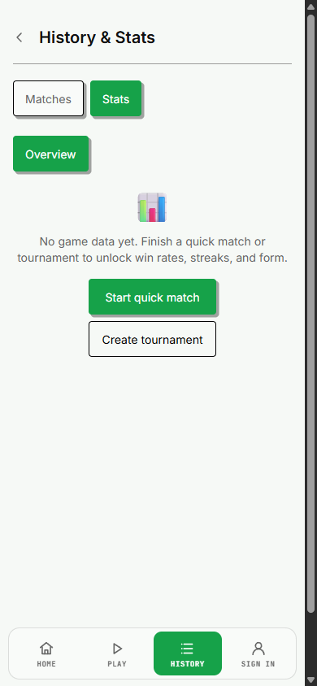
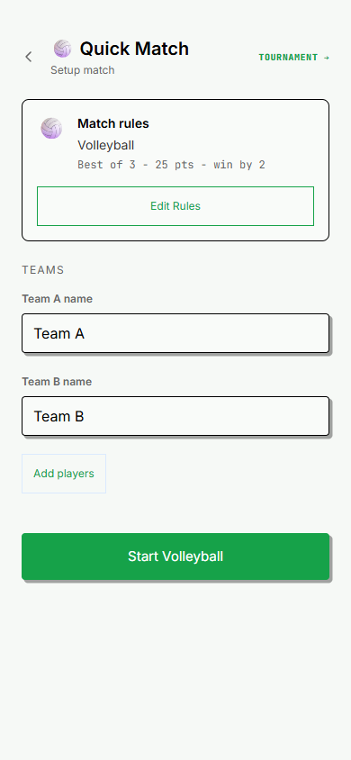
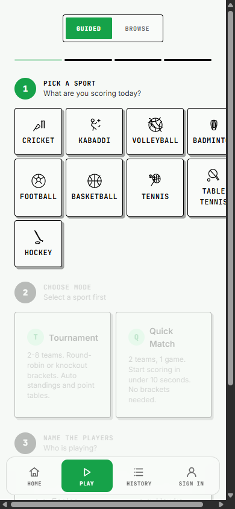

# Generic start-match routing demo

Generic "start a match" CTAs previously dropped scorers into volleyball before
they picked a sport. PR #158 already landed the fix on master (`f895e99`):
Statistics and user-search CTAs use `PLAY_HUB_PATH`, and the default guest
destination is `/play`. Explicit valid guest return targets remain intact.

This integration merges master (`8384956`) into the original local branch without
conflicts. The resulting app source is identical to master. This follow-up adds
the requested demo and records the integration checks.

## Phone demo (rung 5: running local app)

Captured from `bun run dev -- --port 5173 --strictPort` in a fresh guest browser
context, using Chrome DevTools with a 390 by 844 CSS-pixel viewport and device
scale factor 1. Each PNG is 390 by 844 and was visually inspected.

The before capture replays the actual `MonoStatistics.jsx` from the pre-fix base
(`52ed9bf`) against the integrated app. The current file was restored before the
after capture and is unchanged in the committed tree. These are local runtime
screenshots, not a historical production capture. No cloud mutation or match
creation was needed.

1. Open `/history`, select Stats with empty local match storage: the generic
   **Start quick match** CTA appears (before-entry and after-entry).
2. Before: click the CTA; it opens `/volleyball/quick` with **Start Volleyball**.
3. After: click the same CTA; it opens `/play` with sport selection and no sport
   selected. All nine registered sport buttons are present in the rendered DOM.
4. Browser Back returns to `/history`. The History screen defaults to Matches
   after remount; reselecting Stats is a separate UI action.

The existing Play layout clips the fourth sport column at this width. The
screenshots preserve that limitation; this routing integration does not establish
that the entire Play layout passes a mobile usability review.

| Before | After |
| --- | --- |
|  |  |
|  |  |

Machine-readable destinations, viewport dimensions and the Back result are in
[`demo-results.json`](demo-results.json).

## Acceptance checklist

- [x] Merge `origin/master` normally; no conflicts or manual conflict resolutions.
- [x] Inspect and run every expected-failure routing contract: all nine remain
  expected failures. No unrelated contract was changed.
- [x] Run the exact-count palette ratchet: 667. No baseline or exclusion change.
- [x] Statistics quick-match and tournament CTAs open Play (focused tests).
- [x] User-search no-results CTA opens Play (focused test).
- [x] Default guest continuation opens Play; an explicit volleyball return target
  still opens volleyball (focused tests).
- [x] Profile guest-action regression tests pass.
- [x] Capture and inspect both entry and destination states at 390 by 844.
- [x] Walk the reverse path: browser Back returns from Play to History.
- [x] Focused checks: seven files, 79 passing assertions, nine expected failures,
  88 total; no failures. Includes appPaths, Statistics, UserSearch,
  AuthPageFrame, Profile, routes.contract and palette. There is no standalone
  authRedirect test file; appPaths and AuthPageFrame exercise its destinations.
- [x] Lint: zero errors, 29 warnings. Type-check: exit 0 (Convex TypeScript;
  JS/JSX remains unchecked per repository configuration).

Full-suite and production-build evidence is supplied by the normal pre-push
hook and recorded in the PR description after it completes.
