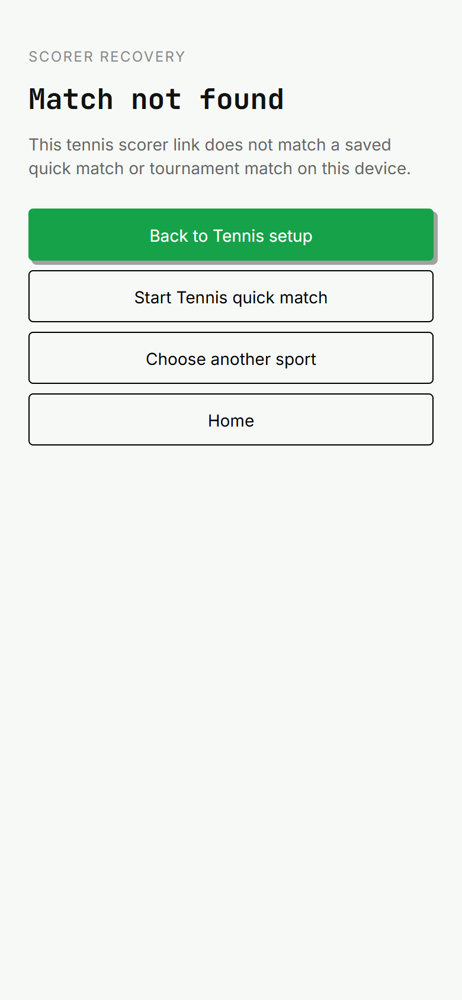
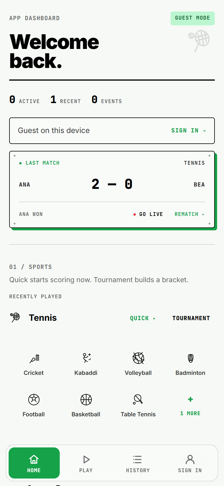
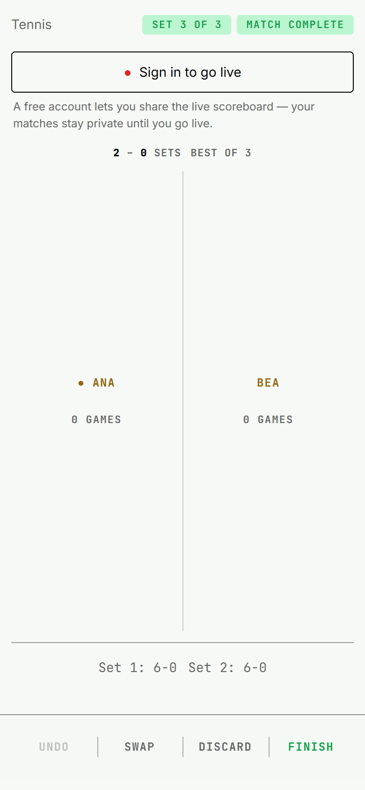
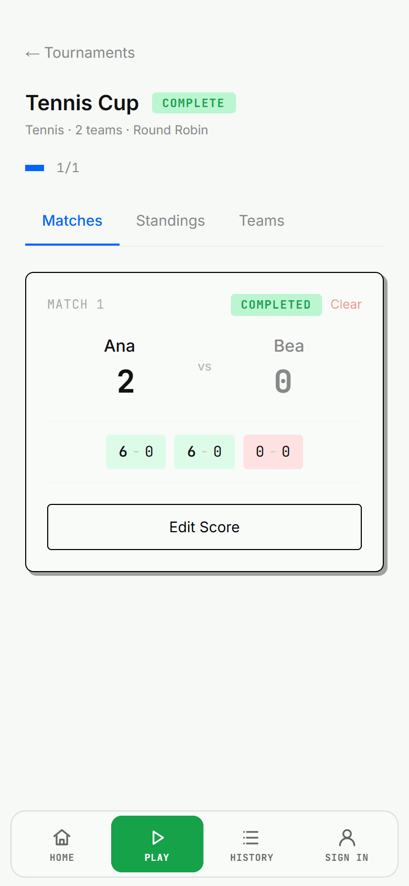

Decisions needed: none. The full-suite lane was released for final integration and normal push.

Current expected-failure inventory after the navigation decisions: **4 routing / 8 repository-wide**. RA-5 now passes normally: setup leaves freely and scoring arms the existing guard. RA-9 also passes normally after the own-key registry lookup. The four stability failures are unchanged. Counts in dated validation runs below describe those historical heads.

Finishing tennis previously pushed the destination, leaving the completed scorer in Back history. Quick tennis then reopened a scorer whose draft had been cleared. Both completion paths now call the existing protected-scoring completion seam after the local save succeeds. The standalone fallback replaces the scorer entry.

Evidence baseline: fetched master `4da859d0674d48e9ee814b391d72e576c9f7526f`; normal merge `eb22dde807e17319c3f0126ee0d5450ef38f02cf`. Conflicts in the audit document, route contracts and route-sweep script were resolved from master's versions, retaining the revised sweep security fix and RA-3 work. Only tennis routing coverage was reapplied.

Browser walkthrough (rung 5): Chrome at 390x844 CSS pixels, device scale 2, served from this worktree at http://localhost:5174. Port 5173 belonged to another worktree and was left untouched. The synthetic quick and tournament fixtures start with Ana winning 6-0, 6-0. Before captures use the fetched master's tennis scorer in the integrated checkout; after captures use the fixed scorer. The source was restored afterward. Every one of the 12 PNGs was opened and inspected.

- Quick: Home Resume -> completed scorer -> Finish -> History showing Ana's 2-0 result -> browser Back. Before: dead scorer, "Match not found". After: Home, 0 active matches, 1 recent result, Ana 2-0 Bea, no dialog.
- Tournament: Tennis Cup Resume Match -> completed scorer -> Finish -> completed tournament -> browser Back. Before: stale completed scorer. After: completed Tennis Cup, Ana 2-0 Bea, no dialog.
- `before.json` and `after.json` record each click, intermediate route, final route, viewport and dialog state. All four flows found and clicked both intended buttons. Raw colour count and all scoring behaviour remain unchanged.
- Browser diagnostics include the pre-existing dev `live:listLiveFeed` backend error on Home and synthetic-click haptics warnings. These did not prevent either flow. Connection tokens are redacted in diagnostics. T3 preview snapshots timed out twice, so the repository's isolated Chrome sweep supplied the screenshots.

Acceptance coverage (rung 4 unless marked otherwise):

- [x] Tennis tournament RA-1 is a new normal regression; tennis quick RA-2 changed from `it.fails` to `it`. Master contained no existing tennis-tournament expected-failure case to convert.
- [x] Back leaves neither a dead scorer nor a completion dialog; saved quick and tournament results retain the full set contract, including the unused third set. Browser proof is described above (rung 5).
- [x] Both modes save before invoking completion, replace when rendered without the provider, and stay in the scorer without clearing the draft when the local save fails.
- [x] Both modes restore a scored draft and its nonempty Undo history after remount; Undo restores the prior score and persists the remaining history.
- [x] After final integration with goals master `0038e60e676bcaecb888037eb1bfac0ecd1c18c0`, goals RA-1 and RA-3 stay fixed alongside tennis RA-1/RA-2. Cricket RA-1 remains open.
- [x] Palette ratchet measures exactly 669. No baseline or exclusion changes.
- [x] Final focused validation: 8 files, 175 passing tests, 10 expected failures (185 total); zero unexpected failures. Includes MonoTennisLiveScore, the merged MonoGoalsLiveScore tests, routes.contract, appEntry, AppEntryRoute, both stability-audit files and palette. There are 6 routing expected failures and 4 stability expected failures, down from master's 7 + 4.
- [x] Lint: 0 errors, 29 warnings. Type-check passed. Normal merge commit hooks passed lint, type-check and agent-config sync. Sweep syntax check passed.
- [ ] Full suite and build: verify the required CI `verify` check. The local pre-push hook selects related tests or the full suite for any tracked deletion/rename and test-environment changes; it does not build. No hosted-check pass is inferred from local validation.

Known limit: the stability audit's SA-07 already records that Undo to an empty history is not autosaved, including tennis (`35cbce6e-7e28-49de-826a-204bb3e46904`). A temporary broader remount test reproduced this for both tennis modes: the board reverted, but storage retained the undone point. This routing patch does not fix that existing defect or claim every persistence scenario is safe. The committed regression covers nonempty history; the audit's four expected-failure stability cases remain unchanged. Winning-point refresh before Finish is also outside this routing proof (SA-04).

Key screenshots after Back:

Each folder also contains `*_scorer_won_.png` immediately before Finish and `*_after_Finish.png` before Back.
